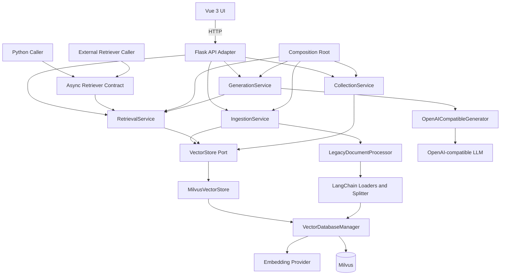
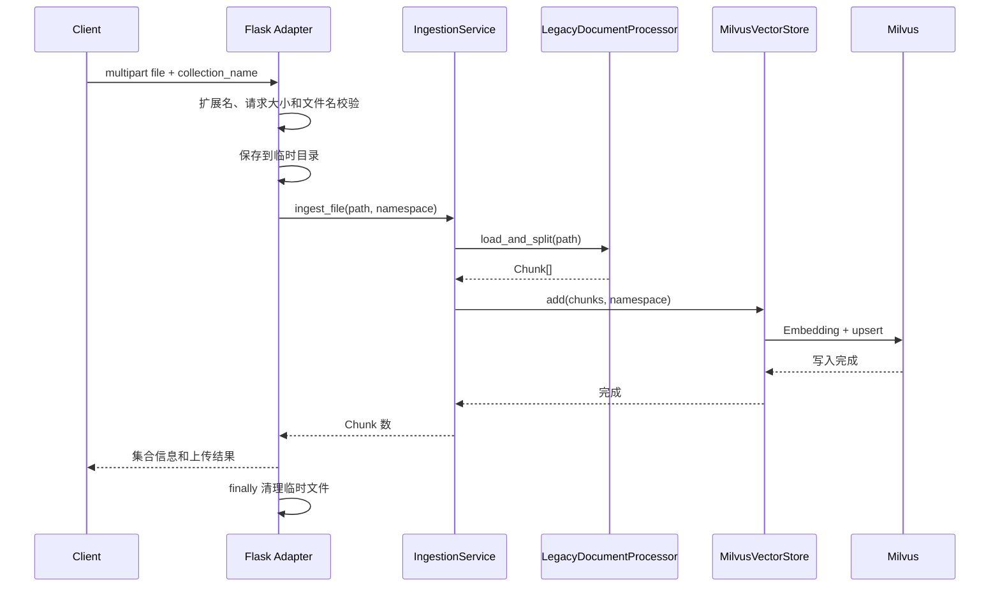

# Bale Knowledge 架构设计

## 1. 文档目的与实现范围

本文描述 Bale Knowledge 当前可运行代码的实际架构，并区分后续扩展方向。当前系统采用模块化单体：Flask、Vue、LangChain、Milvus 和 OpenAI-compatible 服务共同完成同步文档入库、向量检索与生成问答。

领域模型、应用服务和端口已经从 Web 与外部 SDK 中解耦；SQL 元数据、异步 Worker、混合检索和严格证据回答仍属于后续设计，不属于当前实现。

## 2. 架构目标与原则

1. **领域与框架解耦**：Flask 只处理 HTTP，Milvus 只作为 VectorStore 的具体实现。
2. **检索与生成解耦**：调用方可以只获取 `SearchHit`，无需触发生成模型。
3. **外部依赖适配化**：LangChain Document、Milvus 和 OpenAI SDK 不进入领域契约。
4. **集合显式管理**：集合清空必须由明确请求触发，不因普通 Schema 或加载异常自动删除数据。
5. **真实检索分数**：返回 Milvus 相似度分数，不把分数或结果数量转换成答案置信度。
6. **兼容式演进**：保留旧 Flask JSON 和 `VectorRetriever` Python 入口，同时提供新的服务接口。

## 3. 当前系统分层架构



### 3.1 分层职责

| 层 | 当前组件 | 依赖规则 |
|---|---|---|
| 展示层 | Vue `RagChat.vue` | 通过 HTTP 调用后端，不直接访问 Milvus |
| HTTP Adapter | Flask Blueprint、请求校验、DTO 序列化 | 只调用应用服务，不导入 Milvus Manager |
| 组合根 | `composition.py` | 唯一创建具体 Manager、Adapter 和 Service 的位置 |
| 领域层 | `Chunk`、`SearchHit`、`Answer`、Retriever、Ports | 仅使用 Python 标准库 |
| 应用服务层 | Ingestion、Retrieval、Generation、Collection | 只依赖领域模型和端口 |
| 外部适配层 | LegacyDocumentProcessor、MilvusVectorStore、OpenAICompatibleGenerator | 封装 LangChain、Milvus 和模型 SDK |
| 底层实现 | `VectorDatabaseManager` | 保留现有加载、切分、写入、检索和集合操作 |

## 4. 模块划分与核心组件

### 4.1 领域模型与契约

`backend/domain/models.py`：

| 模型 | 当前字段 | 用途 |
|---|---|---|
| `Chunk` | `content`、`metadata` | 在文档处理器和 VectorStore 之间传递待索引内容 |
| `SearchHit` | `content`、`score`、`namespace`、`metadata`、可选来源和 ID | 独立检索结果，不包含生成答案 |
| `Answer` | `answer`、`question_type`、`sources` | 生成结果及其 `SearchHit` 来源 |

`backend/domain/retriever.py` 定义异步契约：

```python
async def search(
    query: str,
    *,
    namespace: str,
    filters: dict | None = None,
    top_k: int = 5,
) -> list[SearchHit]: ...
```

当前真实 RetrievalService 支持 `namespace` 和 `top_k`。非空结构化 `filters` 会显式抛出 `NotImplementedError`；旧 HTTP API 的字符串 `filter_expression` 只通过兼容路径传递。`FakeRetriever` 则在内存中支持 namespace 和 metadata 等值过滤，便于确定性的契约测试。

`backend/domain/ports.py` 定义：

- `DocumentProcessor`：加载并切分内部文件路径。
- `VectorStore`：写入、检索、集合信息和清空。
- `AnswerGenerator`：根据问题与上下文生成文本。

### 4.2 应用服务

| Service | 核心职责 | 当前行为 |
|---|---|---|
| `IngestionService` | 编排加载、切分和 VectorStore 写入 | 同步执行，返回写入 Chunk 数；空内容不写库 |
| `RetrievalService` | 执行检索、相似度阈值过滤、异步接口适配 | 默认阈值 0.5；异步接口使用 `asyncio.to_thread` |
| `GenerationService` | 组织检索、上下文、问题类型和生成 | 上下文格式为“参考资料 N”；异常返回兼容错误 Answer |
| `CollectionService` | 集合信息和清空 | 直接委托 VectorStore 端口 |

Service 可在不启动 Flask 的情况下直接实例化。测试通过内存端口实现验证编排逻辑。

### 4.3 外部适配器

- `LegacyDocumentProcessor` 调用现有 Manager 的 `load_document()` 和 `split_documents()`，并将 LangChain Document 转为 `Chunk`。
- `MilvusVectorStore` 完成 `Chunk → Document` 和 `Document + score → SearchHit` 转换，同时委托集合操作。
- `OpenAICompatibleGenerator` 封装 API Key、Base URL、模型名称、提示词和生成异常。
- `VectorRetriever` 是旧 Python API 的兼容门面，负责把新领域结果转换回旧 `Document` 和 `AnswerResult`。

## 5. 数据流设计

### 5.1 文档上传与入库



当前整个流程在 HTTP 请求内同步完成。原始上传文件不会进入持久化对象存储；临时文件在成功或失败后均尝试删除。同一集合的重复上传没有去重保证。

### 5.2 检索

```text
query + collection_name + k
→ Flask Adapter 或独立 Python 调用
→ RetrievalService
→ MilvusVectorStore.search
→ VectorDatabaseManager.search
→ COSINE 向量检索
→ SearchHit[]
→ 默认 0.5 阈值过滤
→ HTTP JSON 或 Python 返回值
```

`SearchHit.score` 是向量相似度。阈值过滤发生在候选结果返回后，因此候选数量与最终保留数量可能不同。

### 5.3 生成问答

```text
question
→ GenerationService
→ RetrievalService.search_sync
→ 拼接参考资料上下文
→ OpenAICompatibleGenerator
→ Answer(answer, question_type, SearchHit[] sources)
→ Flask 序列化 answer/sources
```

生成器收到空上下文时会使用通用回答提示，因此当前实现不是严格证据拒答流程。

### 5.4 集合信息与清空

Flask 将请求交给 CollectionService，再由 MilvusVectorStore 调用 Manager。清空操作返回是否存在并执行了显式清空；普通集合加载失败不会自动删除整个集合。

## 6. 存储、索引与配置数据

### 6.1 Milvus

- 默认集合名由 `COLLECTION_NAME` 配置，当前为 `agent_rag`。
- 新集合使用 COSINE 度量和 HNSW 索引。
- 当前 HNSW 参数为 `M=16`、`efConstruction=200`。
- `namespace` 在适配层映射为 Milvus `collection_name`。
- 文档 metadata 随 LangChain Document 写入，可用于旧字符串表达式过滤。
- 应用没有独立 SQL 元数据事实源，文档状态和版本不由单独数据库维护。

### 6.2 Embedding 与生成配置

`backend/.env` 同时影响 Embedding、LLM 和 Flask。Embedding 模型与既有集合必须保持一致；不同模型或向量维度不能原地混写。

当前 Manager 在 DashScope 初始化失败时保留 HuggingFace `all-MiniLM-L6-v2` 备用路径。该路径可能需要额外依赖和模型下载，并可能产生不同维度，不能视为透明的生产故障切换。

### 6.3 前端数据

前端仅维护当前浏览器内的集合名、上传状态和对话消息。页面清空对话只影响浏览器状态，不删除 Milvus 数据。API Base 当前写为 `http://localhost:5000/api/vector`。

## 7. 技术栈选型说明

| 技术 | 当前用途 | 选择或保留原因 |
|---|---|---|
| Flask | HTTP API | 保留现有应用入口，当前解耦重点是 Adapter 而非框架迁移 |
| Vue 3 + Vite | 管理与问答页面 | 组件化上传、对话和来源展示 |
| LangChain | Loader、Splitter、Embedding、Milvus 集成 | 复用成熟文档与向量生态 |
| Milvus | 向量存储和检索 | 支持显式集合、metadata 过滤、COSINE/HNSW |
| DashScope / OpenAI-compatible | Embedding 和生成 | 通过远端 API 避免本地模型部署要求 |
| Python dataclass / Protocol | 领域模型与端口 | 无额外框架依赖，便于独立导入和 Fake 实现 |
| `asyncio.to_thread` | 异步 Retriever 外观 | 复用同步 Milvus 客户端，避免阻塞调用方事件循环 |
| pytest | 单元、契约和 API 回归 | Fake 优先，真实 Milvus 显式启用 |

## 8. 扩展点设计

### 8.1 VectorStore

新增向量后端时，应实现写入、检索、集合信息和清空，并保持 `Chunk`/`SearchHit` 契约。Service 不应 import 新后端 SDK；在组合根注册具体实现。

### 8.2 DocumentProcessor

可替换 Loader、结构感知切分或页码/标题定位实现。输出仍是 `Chunk[]`，定位信息进入 metadata，不改变 Flask 上传接口。

### 8.3 AnswerGenerator

可接入其他 OpenAI-compatible 服务或离线 Fake。生成替换不应影响检索 API，也不应改变 `SearchHit` 的分数语义。

### 8.4 Retriever 与外部调用方

外部调用方依赖 `Retriever.search()` 而非 `answer_question()`。`FakeRetriever` 可用于无 Milvus、无 Web 的集成测试。后续 BM25、RRF 或 Rerank 应在 RetrievalService 内部扩展候选与排序流程，保持返回契约稳定。

### 8.5 ServiceContainer

`composition.py` 是替换实现的唯一组装点。Flask 测试可以注入轻量 Service fakes，独立 Python 调用方也可以直接构造 Service，而不依赖全局单例。

## 9. 安全与可靠性设计

### 9.1 当前控制

- multipart 请求限制为 20 MiB，并在读取文件前检查。
- 使用扩展名白名单和安全文件名，文件写入独立临时目录。
- 上传处理使用 `finally` 清理临时文件。
- 集合加载异常不再自动触发整库删除。
- 新结构化 filters 未实现时显式失败，不静默丢弃条件。
- 测试覆盖 TXT、PDF、集合清空、metadata 过滤透传和上传边界。

### 9.2 当前限制

- API 无认证、授权或集合级 ACL，CORS 对开发环境开放。
- `filter_expression` 是旧底层表达式透传，不适合作为不受信用户的通用过滤语言。
- 文件扩展名和 Loader 检查不能替代完整的恶意文件防护。
- 同步上传会占用请求进程，大文件和慢模型调用影响吞吐。
- 没有数据库事务、幂等键或跨 Milvus/元数据的一致性恢复。
- 清空集合是不可逆操作，当前没有审批流程。

生产部署前必须增加认证授权、网络限制、反向代理请求限制、密钥管理、审计和适当执行隔离。

## 10. 测试架构

| 测试类别 | 当前覆盖 |
|---|---|
| 领域独立导入 | 屏蔽 Flask、Milvus、LangChain、OpenAI 后导入领域与 Service |
| Retriever 契约 | Fake 与真实 RetrievalService 共享 namespace、Top-K、顺序和空结果用例 |
| Service 单元测试 | 入库、阈值、生成、异常和集合委托 |
| Adapter 测试 | Chunk/Document/SearchHit 转换和配置传递 |
| Flask 契约回归 | 上传、search、query、collection_info、clear_collection |
| 旧入口兼容 | VectorRetriever 的 Document、AnswerResult 和过滤参数 |
| 文档格式 | TXT、PDF 上传及切分 |
| Milvus smoke | 显式 `MILVUS_INTEGRATION=1` 后验证临时集合完整生命周期 |

默认测试跳过真实 Milvus smoke。只有实际运行该 smoke 后，才能声明当前环境的 Milvus 集成验证通过。

## 11. 后续演进方向

以下内容是扩展设计，不是现有能力：

1. **持久化生命周期**：KnowledgeBase、Document、Chunk、Ingest 状态进入 SQL；原文进入 ObjectStore。
2. **异步入库**：数据库任务表、Worker 租约、幂等键、Checkpoint、重试和版本化重建。
3. **混合检索**：BM25 与向量候选、RRF、可选 Rerank、固定语料对照实验。
4. **检索安全**：结构化 Metadata Filter、Namespace ACL、权限先于生成。
5. **证据回答**：TokenBudget、邻近上下文、标准化 Citation、证据不足拒答和成本追踪。
6. **服务与部署**：在契约稳定后评估 FastAPI、独立 Worker、容器化和Compose。

扩展应保持现有依赖方向：入口适配器调用 Service，Service 依赖端口，具体外部能力停留在 Adapter。
